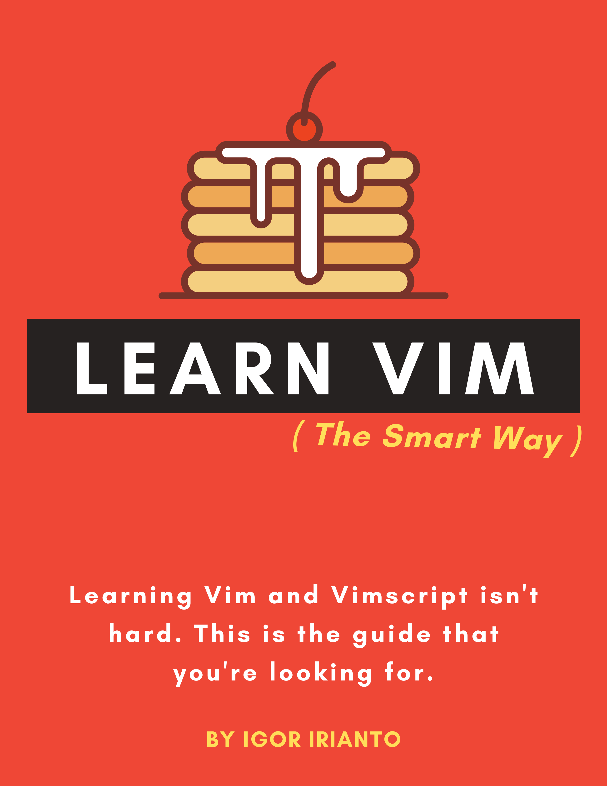

# Learn Vim (the Smart Way)

## What's This?

*Learn Vim (the Smart Way)* is a guide to learn the good parts of Vim.

There are many places to learn Vim: the `vimtutor` is a great place to start and the `help` manual has all the references you will ever need. However, the average user needs something more than `vimtutor` and less than the `help` manual. This guide attempts to bridge that gap by highlighting only the key features to learn the most useful parts of Vim in the least amount of time possible.

This guide is written for both beginner and advanced Vimmers. It starts out with broad and simple concepts and ends with specific and advanced concepts. If you're an advanced user already, I encourage you to read this guide from start to finish anyway, because you may learn something new!

## Read Locally (with Docker)

You can read this book locally with Docker. Just run:

```bash
docker compose -f book/docker-compose.yml up --build
```

Then open [http://localhost:8080](http://localhost:8080).

## I Want More Vim Tips!

Follow [@learnvim](https://twitter.com/learnvim) for updates, Vim tips, etc.

## Support This Project

This guide is and will always be free.

If you want to financially support this project, you can either [purchase this guide on Leanpub](https://leanpub.com/learnvim) or [buy me a coffee](https://www.buymeacoffee.com/iggredible)!

<a href="https://leanpub.com/learnvim"></a>

<a href="https://www.buymeacoffee.com/iggredible" target="_blank"></a>


## Table Of Contents

### Prologue

- [Ch 0     - Read This First](./ch00_read_this_first.md)

### Part 1: Learn Vim the Smart Way

- [Ch 1     - Starting Vim](./ch01_starting_vim.md)
- [Ch 2     - Buffers, Windows, and Tabs](./ch02_buffers_windows_tabs.md)
- [Ch 3     - Opening and Searching Files](./ch03_searching_files.md)
- [Ch 4     - Vim Grammar](./ch04_vim_grammar.md)
- [Ch 5     - Moving in a File](./ch05_moving_in_file.md)
- [Ch 6     - Insert Mode](./ch06_insert_mode.md)
- [Ch 7     - The Dot command](./ch07_the_dot_command.md)
- [Ch 8     - Registers](./ch08_registers.md)
- [Ch 9     - Macros](./ch09_macros.md)
- [Ch 10    - Undo](./ch10_undo.md)
- [Ch 11    - Visual Mode](./ch11_visual_mode.md)
- [Ch 12    - Search and Substitute](./ch12_search_and_substitute.md)
- [Ch 13    - The Global Command](./ch13_the_global_command.md)
- [Ch 14    - External Commands](./ch14_external_commands.md)
- [Ch 15    - Command-line Mode](./ch15_command-line_mode.md)
- [Ch 16    - Tags](./ch16_tags.md)
- [Ch 17    - Fold](./ch17_fold.md)
- [Ch 18    - Git](./ch18_git.md)
- [Ch 19    - Compile](./ch19_compile.md)
- [Ch 20    - Views, Sessions, and Viminfo](./ch20_views_sessions_viminfo.md)
- [Ch 21    - Multiple File Operations](./ch21_multiple_file_operations.md)

### Part 2: Customize Vim the Smart Way

- [Ch 22 - Vimrc](./ch22_vimrc.md)
- [Ch 23 - Vim Packages](./ch23_vim_packages.md)
- [Ch 24 - Vim Runtime](./ch24_vim_runtime.md)

### Part 3: Learn Vimscript the Smart Way

- [Ch 25 - Vimscript Basic Data Types](./ch25_vimscript_basic_data_types.md)
- [Ch 26 - Vimscript Conditionals And Loops](./ch26_vimscript_conditionals_and_loops.md)
- [Ch 27 - Vimscript Variable Scopes](./ch27_vimscript_variable_scopes.md)
- [Ch 28 - Vimscript Functions](./ch28_vimscript_functions.md)
- [Ch 29 - Plugin Example: Writing a Titlecase Plugin](./ch29_plugin_example_writing-a-titlecase-plugin.md)

## Translations
- [Learn-Vim 中文翻译](https://wsdjeg.net/wiki/learn-vim/)(`zh-CN`)
- [Learn-Vim Spanish](https://github.com/victorhck/learn-Vim-es)(`es`)

## License & Copyright
The materials here are all © 2020-2021 Igor Irianto.

<a rel="license" href="http://creativecommons.org/licenses/by-nc-sa/4.0/"></a><br />

This work is licensed under a <a rel="license" href="http://creativecommons.org/licenses/by-nc-sa/4.0/">Creative Commons Attribution-NonCommercial-ShareAlike 4.0 International</a>.


## 🌐 Web Resources & Interactive Index
- [REAL FREEKICK 3D](https://ptskillcrafts.pages.dev/real-freekick-3d.html)
- [INDEX18](https://themindplay.github.io/index18.html)
- [CATEGORY STORY45](https://thelearnquester.web.app/category-story45.html)
- [CATEGORY AVOID295](https://quizverses.github.io/category-avoid295.html)
- [CATEGORY DYKNOW](https://thelearnquester.web.app/category-dyknow.html)
- [TERMS](https://brainquests.vercel.app/terms.html)
- [MUSIC TILES FLUFFY HOP BEAT](https://studyplayings.pages.dev/music-tiles-fluffy-hop-beat.html)
- [BACKWOODS](https://quizverses.github.io/backwoods.html)
- [CATEGORY DRESS UP 2](https://studyquests.github.io/category-dress-up-2.html)
- [KNOCK AND RUN 100 DOORS ESCAPE](https://studyquests.github.io/knock-and-run-100-doors-escape.html)
- [VICE CITY DRIVER](https://quizverses.github.io/vice-city-driver.html)
- [TUNG TUNG SAHUR COLORING BOOK](https://studyquesthub.web.app/tung-tung-sahur-coloring-book.html)
- [OHPEACH IT](https://quizverses.github.io/ohpeach-it.html)
- [DRAW THE WEAPON](https://learnquesters.pages.dev/draw-the-weapon.html)
- [INDEX12](https://learnquester.pages.dev/index12.html)
- [DOLPHIN DASH](https://studyquesthub.web.app/dolphin-dash.html)
- [INDEX2](https://quizverses.github.io/index2.html)
- [ORGANIZE IT](https://thelearnquester.web.app/organize-it.html)
- [HELICOPTER BATTLE STEVE 2 PLAYER](https://studyplayings.web.app/helicopter-battle-steve-2-player.html)
- [EATING SIMULATOR](https://studyquesthub.web.app/eating-simulator.html)
- [CATEGORY FREE](https://studyquests.github.io/category-free.html)
- [MEN VS GORILLAS](https://thelearnquester.web.app/men-vs-gorillas.html)
- [FLAMES FORTUNE](https://thelearnquester.web.app/flames-fortune.html)
- [BRAINROT HOOK SWING](https://studyplayings.pages.dev/brainrot-hook-swing.html)
- [HIGH SPEED CRAZY BIKE](https://studyplayings.web.app/high-speed-crazy-bike.html)
- [POPPING SUSHI](https://studyquesthub.web.app/popping-sushi.html)
- [CATEGORY SOCCER 2](https://learnquesters.pages.dev/category-soccer-2.html)
- [VEGAMIX DA VINCI PUZZLES](https://studyplayings.web.app/vegamix-da-vinci-puzzles.html)
- [CATEGORY FOOTBALL](https://studyplayings.pages.dev/category-football.html)
- [COIN BLITZ](https://studyquesthub.web.app/coin-blitz.html)
- [BLOCK DROPPING MERGE](https://studyplayings.pages.dev/block-dropping-merge.html)
- [CATEGORY MAHJONG37](https://thelearnquester.web.app/category-mahjong37.html)
- [EASY OBBY JUMP AND RUN CHALLENGE ONLINE](https://quizverses.github.io/easy-obby-jump-and-run-challenge-online.html)
- [TRI PEAKS EMERLAND SOLITAIRE](https://thelearnquester.web.app/tri-peaks-emerland-solitaire.html)
- [CATEGORY GOGUARDIANBYPASS](https://studyquests.github.io/category-goguardianbypass.html)
- [CATEGORY SNIPER39](https://learnquester.github.io/category-sniper39.html)
- [HERITAGE MAHJONG CLASSIC](https://studyquests.github.io/heritage-mahjong-classic.html)
- [HEIST DEFENDER](https://studyquesthub.web.app/heist-defender.html)
- [MATH QUEST](https://studyquesthub.web.app/math-quest.html)
- [CAR OUT JAM](https://quizverses.github.io/car-out-jam.html)
- [CATEGORY IO](https://studyquests.pages.dev/category-io.html)
- [CATEGORY CARDS](https://quizverses-9d2f2.web.app/category-cards.html)
- [CUTE ANIMAL WORLD](https://quizverses.github.io/cute-animal-world.html)
- [BANANA BOUNCE](https://thelearnquester.web.app/banana-bounce.html)
- [100 ROOMS ESCAPE](https://studyplayings.web.app/100-rooms-escape.html)
- [CATEGORY JIGSAW](https://studyplayings.pages.dev/category-jigsaw.html)
- [BLOCOPS](https://studyquesthub.web.app/blocops.html)
- [CATEGORY FOOD95](https://studyplayings.pages.dev/category-food95.html)
- [HEXANAUT IO](https://studyplayings.pages.dev/hexanaut-io.html)
- [CATEGORY FPS](https://quizverses-9d2f2.web.app/category-fps.html)
- [FLAG PUZZLE JAM COLLECT FLAGS](https://learnquester.github.io/flag-puzzle-jam-collect-flags.html)
- [SAFE MERGE](https://learnquester.pages.dev/safe-merge.html)
- [SPRUNKI 3D ESCAPE](https://thelearnquester.web.app/sprunki-3d-escape.html)
- [FASHION WEEK 2025](https://thelearnquester.web.app/fashion-week-2025.html)
- [JUMP MAN](https://studyplayings.pages.dev/jump-man.html)
- [CATEGORY ART](https://studyquests.pages.dev/category-art.html)
- [STICK WAR SAGA](https://studyplayings.web.app/stick-war-saga.html)
- [TRAFFIC ESCAPE PUZZLE](https://learnquester.pages.dev/traffic-escape-puzzle.html)
- [FESTIVAL VIBES MAKEUP](https://learnquester.pages.dev/festival-vibes-makeup.html)
- [TAP BEAD](https://quizverses.github.io/tap-bead.html)
- [ANIME DRESS UP DOLL DRESS UP](https://learnquester.pages.dev/anime-dress-up-doll-dress-up.html)
- [CATEGORY BATTLESHIP19](https://studyquests.pages.dev/category-battleship19.html)
- [BUBBLE SHOOTER NEON](https://studyplayings.pages.dev/bubble-shooter-neon.html)
- [CATEGORY NETSUPPORT](https://thelearnquester.web.app/category-netsupport.html)
- [DRIFTCLICKER](https://thelearnquester.web.app/driftclicker.html)
- [CATEGORY CASUAL969](https://studyquests.pages.dev/category-casual969.html)
- [CATEGORY PUZZLE 2](https://learnquester.github.io/category-puzzle-2.html)
- [IDLE INVENTOR](https://studyquesthub.web.app/idle-inventor.html)
- [SHIP CONTROL 3D](https://studyplayings.pages.dev/ship-control-3d.html)
- [COUNTRYSIDE DRIVING QUEST](https://learnquester.pages.dev/countryside-driving-quest.html)
- [DAILY JEWELS BLITZ MAHJONG](https://learnquester.pages.dev/daily-jewels-blitz-mahjong.html)
- [SUPER NINJA BALLOON](https://learnquester.github.io/super-ninja-balloon.html)
- [SUPER ONION BOY 2](https://studyquests.github.io/super-onion-boy-2.html)
- [UNPUZZLE MASTER](https://studyplayings.web.app/unpuzzle-master.html)
- [OFF ROAD OVERDRIVE](https://studyplayings.pages.dev/off-road-overdrive.html)
- [CATEGORY MOUSE1 707](https://studyquesthub.web.app/category-mouse1-707.html)
- [TRAFFIC COP 3D](https://studyplayings.pages.dev/traffic-cop-3d.html)
- [SUPER ELIP ADVENTURE](https://studyquesthub.web.app/super-elip-adventure.html)
- [67 CLICKER](https://learnquester.github.io/67-clicker.html)
- [ZOMBIE ROAD](https://learnquester.pages.dev/zombie-road.html)
- [SPIN SHOT SIEGE](https://quizverses-9d2f2.web.app/spin-shot-siege.html)
- [MATCH COLLECTION](https://studyquests.github.io/match-collection.html)
- [JEWELS BLITZ LEGENDS](https://quizverses-9d2f2.web.app/jewels-blitz-legends.html)
- [DRAW A PATH TO THE FINISH LINE](https://studyquesthub.web.app/draw-a-path-to-the-finish-line.html)
- [BRAINROT A DIFFERENCE CHALLENGE](https://studyquesthub.web.app/brainrot-a-difference-challenge.html)
- [MY DINOSAUR LAND](https://studyplayings.pages.dev/my-dinosaur-land.html)
- [CATEGORY SIMULATION](https://studyplayings.pages.dev/category-simulation.html)
- [STICK FIGHT THE CHAOS](https://studyplayings.web.app/stick-fight-the-chaos.html)
- [CHESSFIELD](https://studyquests.github.io/chessfield.html)
- [PHONE CASE DIY 5](https://thelearnquester.web.app/phone-case-diy-5.html)
- [MOUNTAIN BUS DRIVER](https://quizverses.github.io/mountain-bus-driver.html)
- [CATEGORY SNAKE](https://quizverses.github.io/category-snake.html)
- [CATEGORY COLLECT565](https://studyquests.pages.dev/category-collect565.html)
- [COCKTAILZ](https://studyquests.github.io/cocktailz.html)
- [CATEGORY ADVENTURE 3](https://studyquests.pages.dev/category-adventure-3.html)
- [CATEGORY SNIPER39](https://quizverses-9d2f2.web.app/category-sniper39.html)
- [CATEGORY RACING DRIVING 2](https://studyplayings.pages.dev/category-racing-driving-2.html)
- [ASMR MAKEOVER MAKEUP STUDIO](https://studyplayings.pages.dev/asmr-makeover-makeup-studio.html)
- [SLITHERCRAFT IO](https://studyplayings.web.app/slithercraft-io.html)
- [PYRAMIDZ2](https://learnquester.pages.dev/pyramidz2.html)
- [CATEGORY 1 PLAYER139](https://quizverses-9d2f2.web.app/category-1-player139.html)
- [INDEX32](https://quizverses.github.io/index32.html)
- [SHOT CAN WILD](https://learnquester.pages.dev/shot-can-wild.html)
- [SOLITAIRE EMPEROR SECRETS OF FATE](https://learnquester.pages.dev/solitaire-emperor-secrets-of-fate.html)
- [FRUIT KING MERGE](https://quizverses.github.io/fruit-king-merge.html)
- [LUXURY HIGHWAY CARS](https://learnquester.pages.dev/luxury-highway-cars.html)
- [ELLIE S RECIPE DUBAI CHOCOLATE BAR](https://quizverses.pages.dev/ellie-s-recipe-dubai-chocolate-bar.html)
- [FIGHT TO THE END](https://studyquests.github.io/fight-to-the-end.html)
- [TRIPEAKS SOLITAIRE ESCAPES](https://quizverses.pages.dev/tripeaks-solitaire-escapes.html)
- [FANTASY MADNESS](https://learnquester.pages.dev/fantasy-madness.html)
- [PIRATES MATCH THE LOST TREASURE](https://quizverses.pages.dev/pirates-match-the-lost-treasure.html)
- [CATEGORY STICKMAN175](https://quizverses.pages.dev/category-stickman175.html)
- [CONNECT THE DOTS COLOR LINES](https://learnquester.github.io/connect-the-dots-color-lines.html)
- [CATEGORY SPORTS](https://studyplayings.pages.dev/category-sports.html)
- [GHOST ESCAPE 3D](https://studyplayings.web.app/ghost-escape-3d.html)
- [MONSTER MERGE LEGENDS ALIVE](https://learnquester.pages.dev/monster-merge-legends-alive.html)
- [DARLING DOLL](https://quizverses.pages.dev/darling-doll.html)
- [CATEGORY MAKEUP](https://themindzone.pages.dev/category-makeup.html)
- [CATEGORY CARTOON](https://theskillquest.pages.dev/category-cartoon.html)
- [FROM NERDS TO BEAUTIES](https://thequizzone.pages.dev/from-nerds-to-beauties.html)
- [XMAS HEXA SORT](https://studyquesthub.web.app/xmas-hexa-sort.html)
- [HYPERMARKET 3D STORE CASHIER](https://learnquester.pages.dev/hypermarket-3d-store-cashier.html)
- [CATEGORY TURN BASED30](https://learnquester.github.io/category-turn-based30.html)
- [CATEGORY LINKS](https://studyplayings.pages.dev/category-links.html)
- [BATTLE RACING STARS](https://learnquester.github.io/battle-racing-stars.html)
- [DEVIL DUCK NOT A TROLL GAME](https://quizverses.github.io/devil-duck-not-a-troll-game.html)
- [CATEGORY JUMPING147](https://iskillquest.pages.dev/category-jumping147.html)
- [ENCHANTED EASTER ADVENTURE](https://studyplayings.web.app/enchanted-easter-adventure.html)
- [TRIPEAKS SOLITAIRE ESCAPES](https://learnquester.pages.dev/tripeaks-solitaire-escapes.html)
- [FIND GOODS](https://thequizzone.pages.dev/find-goods.html)
